# End-to-End CI/CD Pipeline on AWS EKS using GitHub Actions

A production-grade, secure Continuous Integration and Continuous Deployment (CI/CD) pipeline built with **GitHub Actions**, containerized with **Docker**, stored in **Amazon ECR**, and deployed onto a high-availability **Amazon EKS (Kubernetes)** cluster with automated health checks and zero-downtime rolling updates.

---

## Architecture Overview

```mermaid
flowchart LR
    A["Developer Commit / PR"] --> B["GitHub Actions Triggered"]
    subgraph CI ["Continuous Integration (CI)"]
        B --> C["Automated Unit Tests\n(node --test)"]
        C --> D["Build Docker Image\n(node:20-alpine)"]
        D --> E["Tag with Git SHA & latest"]
    end
    subgraph CD ["Continuous Deployment (CD)"]
        E --> F["Authenticate & Push\nto Amazon ECR"]
        F --> G["Configure Kubeconfig\n(aws eks)"]
        G --> H["Deploy Manifests\nto Amazon EKS"]
        H --> I["Rollout Verification\n(kubectl rollout status)"]
    end
    I --> J["High Availability Pods\nBehind LoadBalancer Service"]
```



---

## Assessment Requirements Mapped

| Requirement | Implementation Detail | Location |
| :--- | :--- | :--- |
| **1. Runs tests** | Automated unit & probe test suite covering health, readiness, and routing. Runs before any build step. | `app/test/app.test.js` |
| **2. Builds Docker image** | Security-hardened container based on `node:20-alpine`, runs as non-root `node` user with integrated `HEALTHCHECK`. | `Dockerfile` |
| **3. Pushes to ECR** | Authenticates via `aws-actions/amazon-ecr-login` and pushes tagged image with `${{ github.sha }}` and `latest`. | `.github/workflows/ci-cd.yml` |
| **4. Deploys to Kubernetes** | Updates Kubernetes context with `aws eks update-kubeconfig`, substitutes image tag, and applies manifests with rolling updates and verification. | `k8s/` & `.github/workflows/ci-cd.yml` |

---

## Project Structure

```text
Task-1-CICD-EKS/
├── .github/
│   └── workflows/
│       └── ci-cd.yml            # CI/CD pipeline definition
├── app/
│   ├── package.json             # Service metadata and test scripts
│   ├── src/
│   │   ├── app.js               # REST API with /health and /ready endpoints
│   │   └── server.js            # Server entrypoint with graceful shutdown (SIGTERM/SIGINT)
│   └── test/
│       └── app.test.js          # Automated unit test suite
├── k8s/
│   ├── namespace.yaml           # Dedicated Kubernetes namespace (devops-demo)
│   ├── deployment.yaml          # 2 Replicas, RollingUpdate strategy, liveness/readiness probes
│   └── service.yaml             # LoadBalancer service exposing port 80 -> 3000
├── Dockerfile                   # Minimal production-ready container definition
├── .dockerignore                # Build context exclusion rules
└── README.md                    # Project documentation
```

---

## Step-by-Step AWS Setup Guide

### 1. Amazon ECR (Elastic Container Registry)
Create a private repository in your chosen AWS Region (`us-east-1`):
```bash
aws ecr create-repository \
    --repository-name cloud-api-service \
    --region us-east-1 \
    --image-scanning-configuration scanOnPush=true
```

### 2. Amazon EKS Cluster
If you already have a cluster named `devops-eks-cluster`:
```bash
aws eks describe-cluster --name devops-eks-cluster --region us-east-1
```
Or create a cost-effective test cluster with `eksctl`:
```bash
eksctl create cluster \
    --name devops-eks-cluster \
    --region us-east-1 \
    --nodegroup-name standard-workers \
    --node-type t3.medium \
    --nodes 2 \
    --nodes-min 1 \
    --nodes-max 3 \
    --managed
```

### 3. GitHub Repository Secrets
Navigate to **GitHub Repository** -> **Settings** -> **Secrets and variables** -> **Actions** -> **New repository secret**:

| Secret Name | Value | Purpose |
| :--- | :--- | :--- |
| `AWS_ACCESS_KEY_ID` | `AKIA...` | IAM user with permissions to ECR and EKS |
| `AWS_SECRET_ACCESS_KEY` | `wJalr...` | AWS Secret Access Key |

> **Security Note:** In enterprise environments, AWS IAM OIDC (OpenID Connect) role assumption is preferred over long-lived keys. This pipeline supports IAM credentials and is easily upgradeable to OIDC via `role-to-assume`.

### 4. EKS IAM Access Permission
Ensure your IAM user or role has access to the EKS cluster API. If using EKS Access Entries:
```bash
aws eks create-access-entry \
    --cluster-name devops-eks-cluster \
    --principal-arn arn:aws:iam::<ACCOUNT_ID>:user/<USER_OR_CI_ROLE> \
    --region us-east-1

aws eks associate-access-policy \
    --cluster-name devops-eks-cluster \
    --principal-arn arn:aws:iam::<ACCOUNT_ID>:user/<USER_OR_CI_ROLE> \
    --policy-arn arn:aws:eks::aws:cluster-access-policy/AmazonEKSClusterAdminPolicy \
    --access-scope type=cluster \
    --region us-east-1
```

---

## Local Verification & Testing

### 1. Run Unit Tests Locally
```bash
cd app
npm test
```
**Output:**
```text
▶ Cloud API Microservice Unit Tests
  ✔ GET / returns 200 with success status and metadata
  ✔ GET /health (Liveness Probe) returns 200 and healthy status
  ✔ GET /ready (Readiness Probe) returns 200 and ready status
  ✔ GET /api/v1/info returns cloud and orchestrator metadata
  ✔ GET /unknown-endpoint returns 404 Not Found
✔ Cloud API Microservice Unit Tests
ℹ tests 5 | pass 5 | fail 0
```

### 2. Build and Test Docker Container
```bash
# Build image
docker build -t cloud-api-service:local .

# Run container locally
docker run -d -p 3000:3000 --name test-api cloud-api-service:local

# Test endpoints
curl http://localhost:3000/
curl http://localhost:3000/health
curl http://localhost:3000/ready

# Clean up
docker stop test-api && docker rm test-api
```

---

## Production & Interview Talking Points

1. **Why Alpine and Non-Root User in Docker?**
   - We used `node:20-alpine` to minimize image footprint (< 150MB) and attack surface.
   - We explicitly switch to `USER node` to satisfy the principle of least privilege, preventing container escape attacks from gaining host root access.

2. **How does Zero Downtime Deployment work in Kubernetes?**
   - The deployment manifest specifies:
     ```yaml
     strategy:
       type: RollingUpdate
       rollingUpdate:
         maxSurge: 1
         maxUnavailable: 0
     ```
   - Kubernetes spins up a new pod with the new image version, waits for its `readinessProbe` to pass on `/ready`, redirects live traffic to it, and only then terminates the old pod.

3. **How does Graceful Shutdown work?**
   - On pod termination, Kubernetes sends `SIGTERM`. The application catches `SIGTERM`, stops taking new connections via `server.close()`, drains existing in-flight HTTP requests, and shuts down cleanly within the grace period.

4. **Pipeline Rollout Verification:**
   - Instead of blindly triggering `kubectl apply`, our CI/CD pipeline executes:
     `kubectl rollout status deployment/cloud-api-deployment -n devops-demo --timeout=180s`
   - If a pod crashes (e.g. `CrashLoopBackOff` or failed probe), the pipeline immediately fails and alerts the team without leaving the cluster in an inconsistent state.
