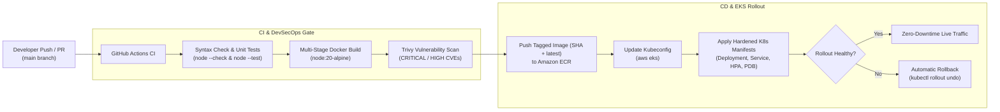

# Production CI/CD Pipeline on AWS EKS with GitHub Actions

An enterprise-hardened, end-to-end Continuous Integration, Security Scanning (DevSecOps), and Continuous Deployment (CI/CD) pipeline built with **GitHub Actions**, multi-stage **Docker**, **Trivy**, **Amazon ECR**, and **Amazon EKS (Kubernetes)**.

---

## Architecture Overview



---

## Production Best Practices Implemented

### 1. Application Hardening (`app/`)
- **Zero Third-Party Dependencies**: Built using native Node.js (`node:http`, `node:test`) to eliminate supply-chain risks and reduce image size.
- **Structured JSON Logging**: Outputs timestamp, HTTP method, path, status code, and latency (`durationMs`) for CloudWatch / ELK ingestion.
- **HTTP Security Headers**: Enforces `X-Content-Type-Options: nosniff`, `X-Frame-Options: DENY`, and `Cache-Control: no-store`.
- **Zero-Downtime Graceful Shutdown**: On `SIGTERM`, `/ready` immediately returns `503 Service Unavailable` so the LoadBalancer stops routing new requests while `server.close()` drains active connections cleanly.

### 2. Container & DevSecOps Best Practices (`Dockerfile`, `.github/workflows/ci-cd.yml`)
- **Multi-Stage Build**: Runs unit tests in the `builder` stage and copies only runtime files to a minimal `node:20-alpine` `runner` stage.
- **Least Privilege Container**: Runs as unprivileged non-root `USER node` (UID `1000`).
- **Trivy Vulnerability Scanning**: Scans the built container image for `CRITICAL` and `HIGH` CVEs before pushing to Amazon ECR.
- **Immutable SHA Tagging & Concurrency Control**: Tags images with `${{ github.sha }}` for full commit traceability and uses GitHub Actions `concurrency` groups to prevent race conditions.
- **Automated Rollback**: Automatically runs `kubectl rollout undo` if `kubectl rollout status` fails.

### 3. Kubernetes Hardening (`k8s/`)
- **Pod & Container `securityContext`**: Enforces `runAsNonRoot: true`, `readOnlyRootFilesystem: true`, `allowPrivilegeEscalation: false`, `automountServiceAccountToken: false`, `seccompProfile: RuntimeDefault`, and drops `ALL` Linux capabilities.
- **All 3 Kubernetes Probes**: Configured `startupProbe`, `livenessProbe` (`/health`), and `readinessProbe` (`/ready`).
- **High Availability**: `RollingUpdate` (`maxSurge: 1`, `maxUnavailable: 0`), `PodDisruptionBudget` (`minAvailable: 1`), and `HorizontalPodAutoscaler` (2–5 replicas at 70% CPU).

---

## Project Structure

```text
Task-1-CICD-EKS/
├── .github/
│   └── workflows/
│       └── ci-cd.yml            # CI/CD + Trivy scan + Auto-rollback workflow
├── app/
│   ├── package.json             # Service descriptors & test scripts
│   ├── src/
│   │   ├── app.js               # REST API, JSON logs, security headers, probes
│   │   └── server.js            # Entrypoint with graceful SIGTERM shutdown
│   └── test/
│       └── app.test.js          # Automated unit & security test suite
├── k8s/
│   ├── namespace.yaml           # Namespace (devops-demo)
│   ├── deployment.yaml          # Security-hardened Deployment + 3 probes
│   ├── service.yaml             # LoadBalancer Service (80 -> 3000)
│   ├── hpa.yaml                 # HorizontalPodAutoscaler (CPU 70%)
│   └── pdb.yaml                 # PodDisruptionBudget (minAvailable: 1)
├── Dockerfile                   # Multi-stage non-root Alpine container
├── .dockerignore                # Excludes .git, docs, workflows, manifests
└── README.md                    # Documentation
```

---

## Local Testing

```powershell
# Run syntax check and unit tests
cd app
node --check src/app.js
node --check src/server.js
npm test

# Build & run locally with Docker
cd ..
docker build -t cloud-api-service:local .
docker run -d -p 3000:3000 --read-only --name api-test cloud-api-service:local
curl http://localhost:3000/health
docker stop api-test; docker rm api-test
```

---

## AWS & GitHub Setup Steps

1. **Create Amazon ECR Repository**:
   ```bash
   aws ecr create-repository --repository-name cloud-api-service --region us-east-1 --image-scanning-configuration scanOnPush=true
   ```
2. **Create Amazon EKS Cluster**:
   ```bash
   eksctl create cluster --name devops-eks-cluster --region us-east-1 --nodegroup-name workers --node-type t3.small --nodes 2 --managed
   ```
3. **Configure GitHub Repository Secrets** (`Settings -> Secrets and variables -> Actions`):
   - `AWS_ACCESS_KEY_ID`
   - `AWS_SECRET_ACCESS_KEY`
4. **Push to GitHub (`gawadeAnkit`)**:
   ```bash
   git push -u origin main
   ```
